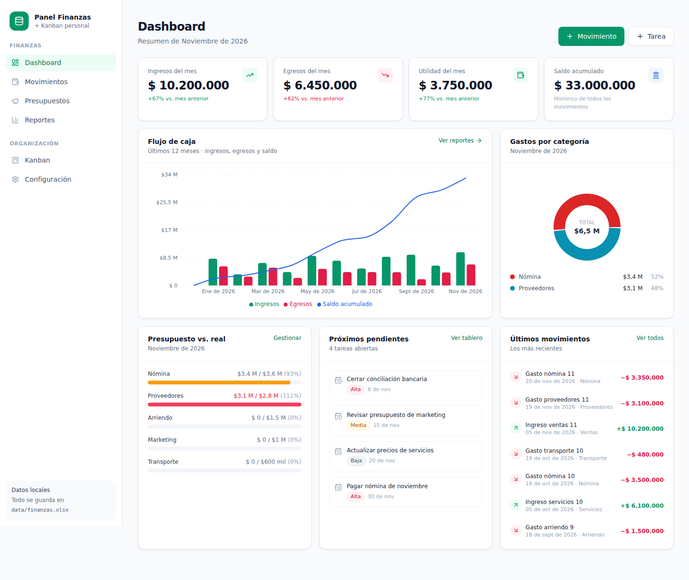
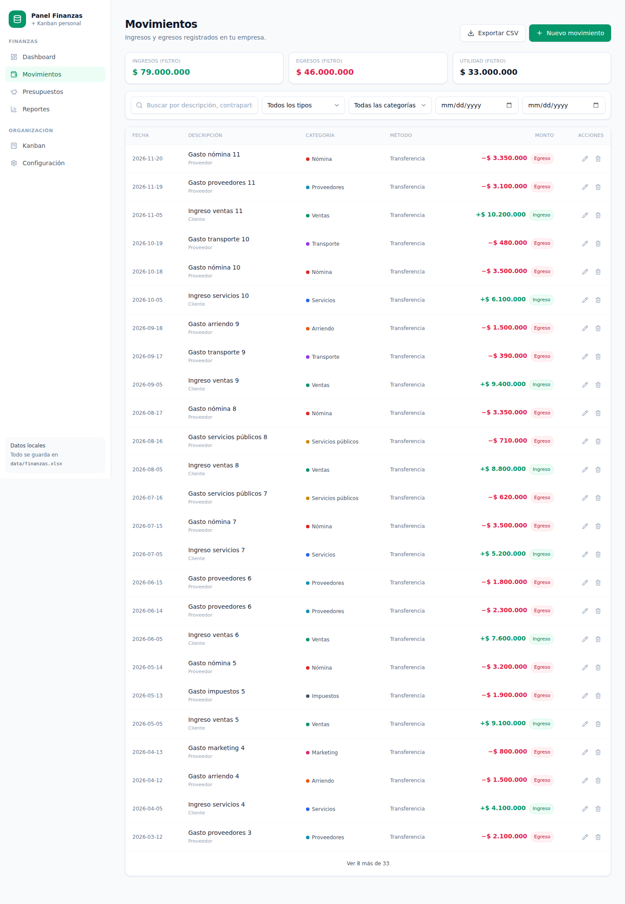
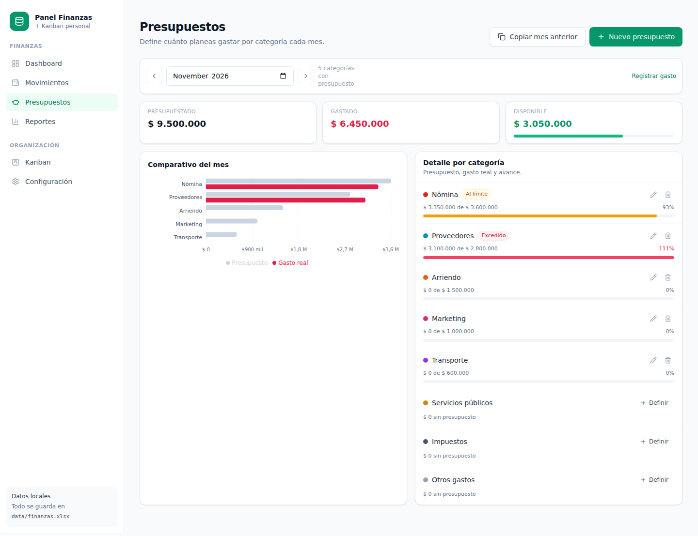
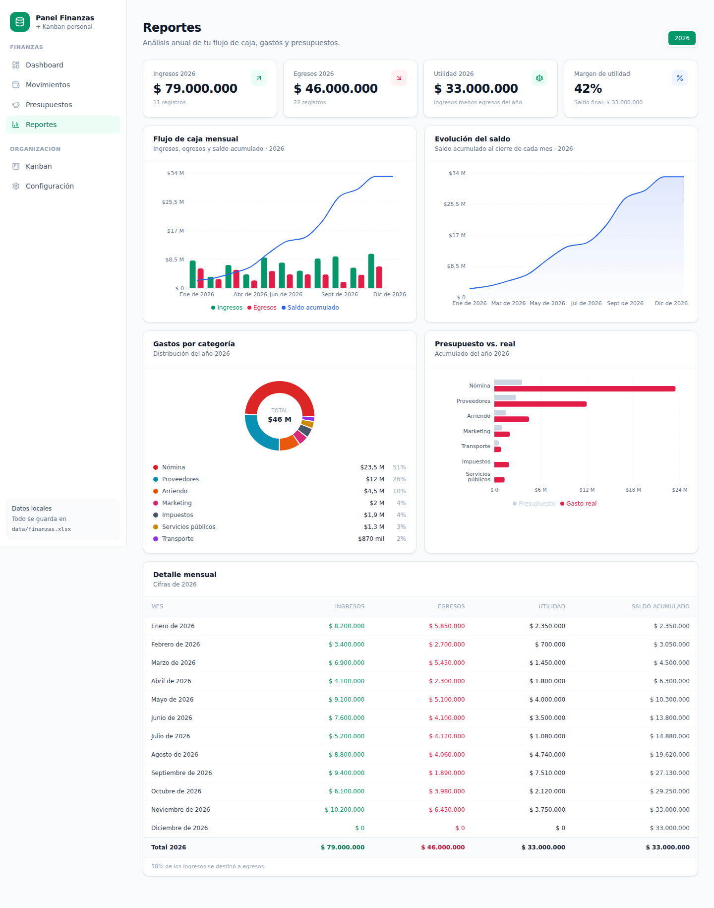
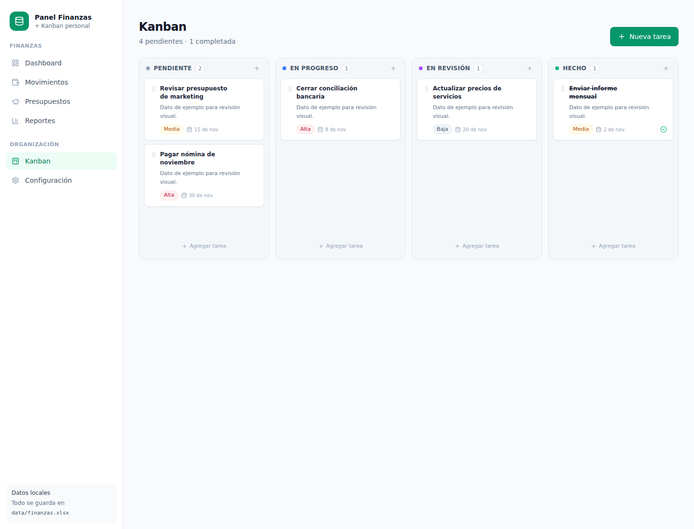

# Panel Finanzas + Kanban

[](https://github.com/Santiagoaghhh/finance-kanban-dashboard/actions/workflows/ci.yml)
[](LICENSE)

Aplicación local para llevar el control financiero de tu empresa y organizar tus
pendientes en un tablero Kanban. Todo se guarda en un único archivo de Excel
(`data/finanzas.xlsx`), sin base de datos, sin login y sin servicios externos.

> **Capturas con datos de ejemplo.** La aplicación arranca vacía y el archivo Excel
> se crea automáticamente en el primer uso.

## Capturas

| Dashboard | Movimientos |
|---|---|
|  |  |

| Presupuestos | Reportes |
|---|---|
|  |  |

| Kanban |
|---|
|  |

## Qué incluye

- **Dashboard** con ingresos, egresos, utilidad del mes, saldo acumulado, flujo de
  caja de 12 meses, gastos por categoría, presupuesto vs. real y últimos movimientos.
- **Movimientos**: registrar, editar, eliminar y filtrar ingresos/egresos. Exportación
  a CSV.
- **Presupuestos**: monto mensual por categoría, avance, alertas al 80 % y 100 %, y
  opción de copiar el presupuesto del mes anterior.
- **Reportes**: flujo de caja anual, evolución del saldo, gastos por categoría,
  presupuesto vs. real y detalle mensual.
- **Kanban** de cuatro columnas (Pendiente, En progreso, En revisión, Hecho) con
  arrastrar y soltar, prioridad y fecha límite.
- **Configuración**: categorías, métodos de pago, estadísticas y respaldos.

Todos los montos se muestran en **pesos colombianos (COP)** con formato `es-CO`.

## Requisitos

- Node.js 18 o superior (probado con Node 22).
- npm.

## Instalación y uso

```bash
npm install
npm run dev
```

Abre [http://localhost:3000](http://localhost:3000). En el primer arranque se crea
automáticamente `data/finanzas.xlsx` con las categorías iniciales.

Para producción:

```bash
npm run build
npm start
```

Si el puerto 3000 está ocupado:

```bash
npm run dev -- -p 3001
```

## Archivo de datos

Ruta: `data/finanzas.xlsx`. Contiene cinco hojas:

| Hoja | Contenido |
|---|---|
| `Movimientos` | Fecha, tipo, categoría, descripción, monto, método de pago, contraparte y notas. |
| `Categorías` | Nombre, tipo (Ingreso/Egreso), color y estado activo. |
| `Presupuestos` | Mes (`AAAA-MM`), categoría y monto. |
| `Tareas` | Título, descripción, columna, prioridad, fecha límite y orden. |
| `Config` | Moneda y métodos de pago. |

Recomendaciones:

- Usa la aplicación para editar los datos. Si abres el Excel directamente, no
  cambies los encabezados ni las hojas.
- No dejes el archivo abierto en Excel mientras guardas desde la app: se mostrará
  un aviso y el cambio no se aplicará.
- Cada escritura crea un respaldo automático en `data/backups/`. Se conservan los
  últimos 10.

### Restaurar un respaldo

1. Cierra la aplicación.
2. Copia el respaldo elegido sobre `data/finanzas.xlsx`.
3. Vuelve a iniciar la aplicación.

### Empezar de cero

1. Cierra la aplicación.
2. Elimina `data/finanzas.xlsx` (opcionalmente también `data/backups/`).
3. Ejecuta `npm run dev`: el archivo se recrea con las categorías base.

## Estructura del proyecto

```
app/
  page.tsx                     Dashboard
  finanzas/movimientos/        Movimientos
  finanzas/presupuestos/       Presupuestos
  finanzas/reportes/           Reportes
  kanban/                      Tablero Kanban
  configuracion/               Ajustes y respaldos
  actions/                     Server Actions (CRUD)
components/                    UI, gráficos, formularios y tablero
lib/
  excel/                       Lectura/escritura del Excel y repositorios
  finance.ts                   Agregaciones y cálculos
  format.ts                    Formatos COP, fechas y meses
  schemas.ts                   Validación con Zod
data/
  finanzas.xlsx                Datos (generado automáticamente)
  backups/                     Respaldos automáticos
```

## Notas

- Es una aplicación de un solo usuario, pensada para ejecutarse en tu computador.
- No incluye facturación electrónica, IVA ni integración con el SII: es control
  interno.
- La moneda y los métodos de pago se pueden ajustar desde **Configuración**.
- Las tareas vencidas se resaltan en rojo y aparecen en el dashboard.
- GitHub aloja únicamente el código. Los datos financieros nunca se publican:
  `data/*.xlsx`, `data/backups/` y `.env*` están excluidos en `.gitignore`.

## Licencia

Distribuido bajo la licencia [MIT](LICENSE). © 2026 Santiagoaghhh.
